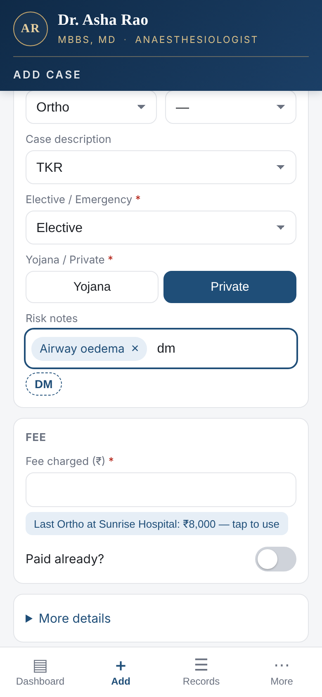
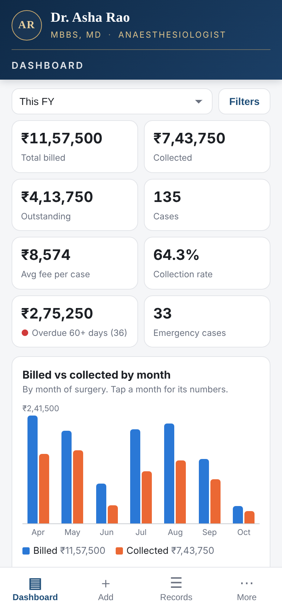
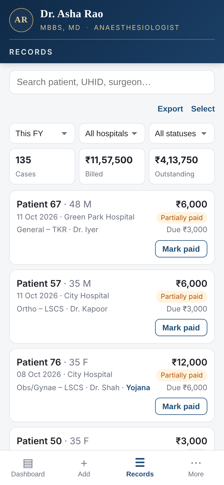
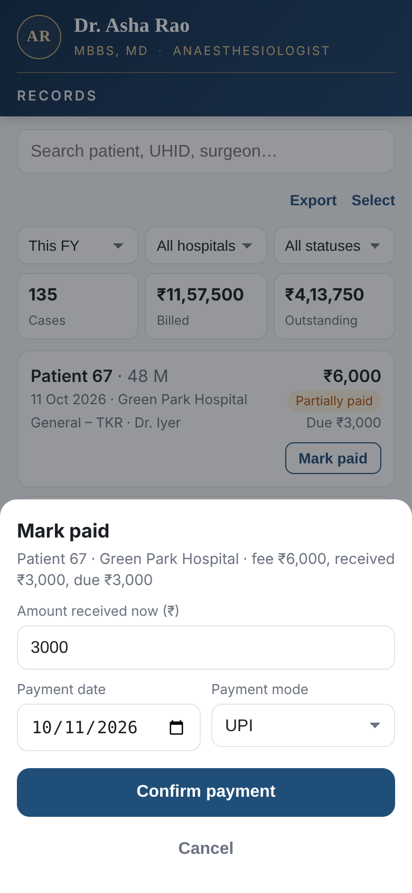

# Medical Freelancer Case Tracker

A free, phone-first app for doctors who work freelance across several hospitals: log each case in under 30 seconds, track who has paid and who still owes, and see earnings at a glance. It replaces the paper ledger.

Built for a freelance anaesthesiologist; it suits any doctor billing per case across institutions.

**Cost: ₹0.** It runs entirely on a Google account: Google Sheets is the database, Google Apps Script is the server and the app, and the data can be downloaded as Excel at any time.

<p>
  
  
  
  
</p>

*Screenshots use made-up demo data.*

## Features

| Area | What it does |
|---|---|
| **Add case** | Date, patient name, age, gender, IP/UHID, hospital, surgeon, case type, anaesthesia type, case description, elective/emergency, Yojana/private, risk notes, fee. Dropdowns learn new hospitals, surgeons and descriptions as they are typed. Suggests the last fee charged for the same hospital and case type. |
| **Risk notes** | Tag-style input. Every note typed becomes vocabulary and is suggested again when its letters are typed, matching anywhere in the word. |
| **Records** | Search, filters, edit, one-tap **Mark paid** (full or partial), multi-select to settle a hospital's pending cases in one go, **Export** of the filtered view to Excel. |
| **Dashboard** | Billed, collected, outstanding, collection rate, overdue dues; charts by month, hospital, case type, surgeon, ageing of dues, payment status, elective/emergency, Yojana/private, age group and gender. Every chart filters by period, hospital, case type, surgeon, status, payment mode and more; tapping a bar opens those cases. |
| **Safe deletes** | Select and delete any filtered set of cases. They go to Trash for 30 days, with Undo, Restore and a typed confirmation for large deletes. |
| **Backups** | One-tap and automatic monthly Excel backups to Google Drive (newest 12 kept). |
| **Access** | Only the Google accounts listed in Settings can open the app or the data. |

## How it works

```
iPhone / Android browser  ──►  Google Apps Script web app  ──►  Google Sheet (Cases · Lists · Trash · Settings)
   (home-screen shortcut)        Code.gs + Index.html               └─► Google Drive: Excel exports + monthly backups
```

| Layer | Tool |
|---|---|
| Database | Google Sheets ([template](template/case_tracker_backend.xlsx)) |
| Server | Google Apps Script ([`src/Code.gs`](src/Code.gs)) |
| App (all screens) | One HTML file served by Apps Script ([`src/Index.html`](src/Index.html)), no frameworks |
| Scheduled jobs | Apps Script triggers: nightly Trash clean-up, monthly backup |

## Setup (about 20 minutes)

1. **Create the database.** Upload [`template/case_tracker_backend.xlsx`](template/case_tracker_backend.xlsx) to Google Drive and open it with Google Sheets. It is saved as a Google Sheet. Delete example row 2 on the Cases tab.
2. **Add the code.** In the Sheet, open **Extensions → Apps Script**. Replace `Code.gs` with [`src/Code.gs`](src/Code.gs). Add an HTML file named `Index` and paste in [`src/Index.html`](src/Index.html). In Project Settings, set the time zone.
3. **Run setup once.** In the function dropdown, run `setupSheet` (dropdowns and settings rows), then `installTriggers` (nightly clean-up and monthly backup). Approve the permissions: *Advanced → Go to project → Allow*.
4. **Fill the Settings tab.** Enter the doctor name and credentials (shown at the top of every screen), the owner and editor emails (only these accounts get in), and the Hospitals and Surgeons on the Lists tab.
5. **Deploy.** Go to **Deploy → New deployment → Web app**, with *Execute as: User accessing the web app* and *Who has access: Anyone with Google account*. Copy the `/exec` URL.
6. **Install on the phone.** Open the URL in Safari or Chrome, sign in, and tap *Share → Add to Home Screen*.

To update later, paste the new code, then go to **Deploy → Manage deployments → Edit → New version**. The URL stays the same.

> **iPhone tip:** if Safari shows *"Sorry, unable to open the file at present"*, more than one Google account is signed in. Sign out of all accounts and sign in with just the one listed in Settings.

<details>
<summary>Using Google's <code>clasp</code> command-line tool instead of copy-paste</summary>

```bash
npm install -g @google/clasp
clasp login
clasp clone <your-script-id> --rootDir src   # Script ID: Apps Script → Project Settings
clasp push
```
</details>

## Settings (Settings tab)

| Setting | Default | Effect |
|---|---|---|
| Financial year start month | 4 (April) | "This FY" / "Last FY" filters |
| Ageing buckets | 30 / 60 / 90 days | Ageing-of-dues chart |
| Overdue threshold | 60 days | Overdue KPI |
| Trash retention | 30 days | Nightly purge |
| Bulk-delete typed confirmation above | 20 cases | Requires typing DELETE |
| Undo banner | 10 seconds | Undo window after a delete |
| Owner / editor email | blank | Once filled, only these accounts can use the app |
| Backup folder name | Case Tracker Backups | Drive folder for backups |
| Doctor name / Credentials | blank | Header on every screen |

## Data model

One row per case on the **Cases** tab. Balance and payment status are sheet formulas. Full column list: [docs/spec.md](docs/spec.md).

## Privacy

Patient data lives only in the owner's Google Sheet, never in this repository. The app runs as the signed-in user, so it can only read what that account has been shared. Keep the Sheet private, share it only with the accounts listed in Settings, and turn on 2-step verification.

## Licence

[MIT](LICENSE)
